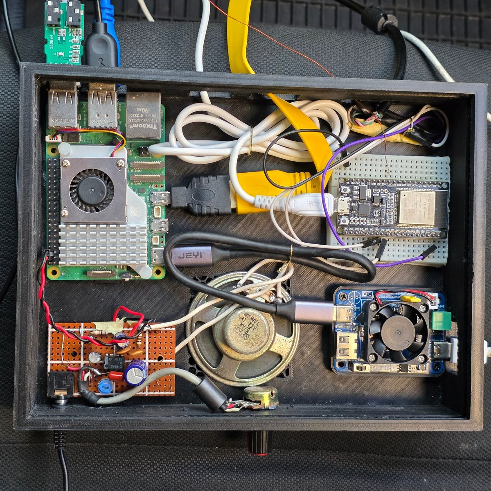
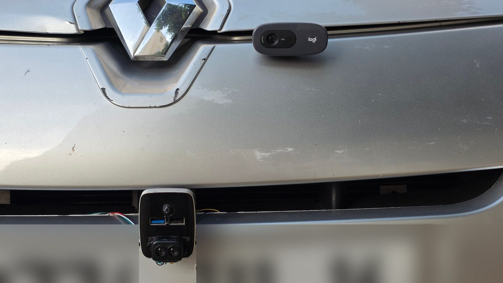
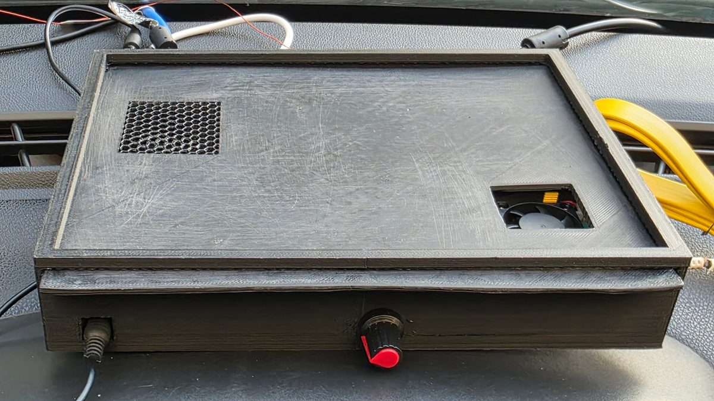
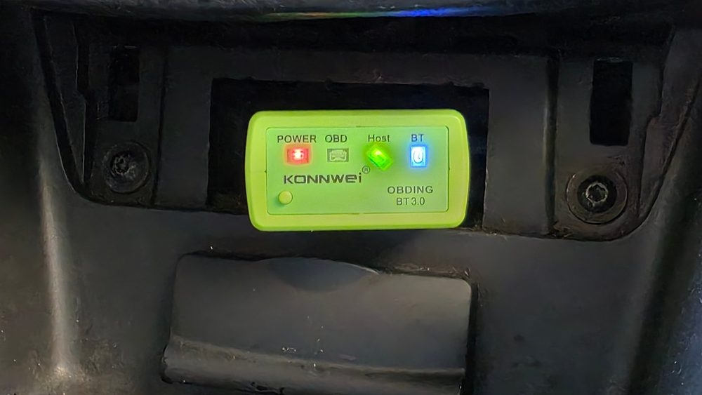
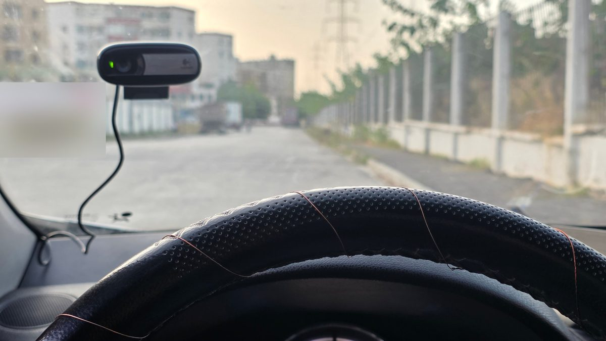
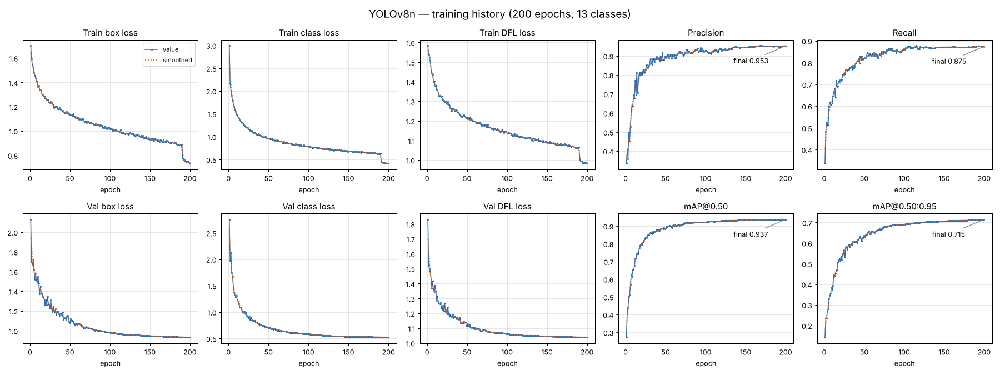

# SHIELD — Embedded Road Safety System

**SHIELD** (*Système Embarqué Intelligent pour la Sécurité Routière*) is a driver assistance system that runs inside a car. It watches the road, the driver and the vehicle at the same time, and warns the driver with a screen and voice alerts.

| Part | Sensor | What it detects |
|---|---|---|
| Road | Front camera + YOLOv8 model | Speed limits, stop, give way, crossings, traffic lights, curves, speed bumps, damaged road |
| Road surface | TF-Luna LiDAR | Potholes and speed bumps, with their distance |
| Driver | Driver camera | Sleepiness (eyes closed) and yawning |
| Driver | Touch sensor on the wheel | Hands off the steering wheel |
| Vehicle | ELM327 OBD-II (Bluetooth) | Engine overheating, fuel, turbo, voltage, brake faults, harsh braking or acceleration |

The system runs on two boards:

```
 Road camera ──┐                                   ┌── TF-Luna LiDAR (UART)
 Driver camera ┼── Raspberry Pi 5 ◄── USB serial ──┤── ESP32 ── Touch sensor (wheel)
 Screen + audio┘   (AI, dashboard)                 │           Buzzer
                                                   └── ELM327 OBD-II (Bluetooth)
```

- **Raspberry Pi 5**: runs the two cameras, the AI model, the fault rules and the dashboard (1024×600 screen).
- **ESP32**: reads the LiDAR, the touch sensor and the car's OBD data, and sends everything to the Pi.

<p align="center">
  
  
</p>
<p align="center"><i>Left: inside the box (Raspberry Pi 5, ESP32, power board, audio amplifier and speaker).
Right: road camera on the hood and TF-Luna LiDAR at the front.</i></p>

---

## 1. Get the code

```bash
git clone https://github.com/AbdouNaili/SHIELD-Road-Safety-System.git
cd SHIELD-Road-Safety-System
```

```
SHIELD-Road-Safety-System/
├── raspberry-pi/            Python app (dashboard + AI)
│   ├── main.py              start here
│   ├── config.py            all settings (ports, cameras, thresholds)
│   ├── app.py               dashboard
│   ├── splash.py            start screen (waits for the ESP32)
│   ├── road_detector.py     road camera + YOLOv8 TFLite model
│   ├── driver_monitor.py    driver camera (eyes and mouth)
│   ├── fault_detector.py    vehicle fault rules (OBD data)
│   ├── serial_manager.py    link with the ESP32
│   ├── audio_manager.py     voice alerts
│   ├── models/              trained YOLOv8 model (.pt and .tflite)
│   ├── sounds/              WAV alert files go here
│   ├── sign_icons/          speed sign pictures go here
│   ├── requirements.txt
│   ├── launch.sh            starts the app
│   └── setup.sh             starts the app automatically at boot
├── esp32/esp32_main/        ESP32 firmware
├── hardware/enclosure/      3D-printable box (STL)
├── images/                  pictures and graphs used in this README
└── training/                notebooks to train and export the model
```

---

## 2. Hardware

- Raspberry Pi 5 + 1024×600 screen + speaker
- 2 USB cameras (road and driver)
- ESP32 DevKit (the classic ESP32, **not** S3 or C3: classic Bluetooth is needed for the ELM327)
- TF-Luna LiDAR, mounted at the front and pointing at the road
- ELM327 OBD-II Bluetooth adapter
- A metal plate or wire on the steering wheel (touch sensor)
- Buzzer
- 3D-printed enclosure (see below)

### Enclosure

Two STL files in `hardware/enclosure/`, in millimetres:

| File | Size | Description |
|---|---|---|
| `enclosure_box.stl` | 212 × 160 × 40 mm | Box with side openings for the cables |
| `enclosure_lid.stl` | 204 × 167 × 3 mm | Sliding lid with two hexagon vent grilles |

The lid slides into a groove at the top of the box walls; the part that sticks out is the handle. You can open the files in any slicer (Cura, PrusaSlicer, Bambu Studio). Print the lid flat.

<p align="center">
  
</p>
<p align="center"><i>Closed box on the dashboard: speaker grille, power-board fan and volume knob</i></p>

---

## 3. ESP32

### Wiring

| ESP32 | Connected to |
|---|---|
| GPIO 16 (RX2) | TF-Luna TX |
| GPIO 17 (TX2) | TF-Luna RX |
| 5V / GND | TF-Luna power |
| GPIO 27 (T7) | Touch plate on the wheel |
| GPIO 25 | Buzzer |
| USB | Raspberry Pi |

### Set your ELM327 address

<p align="center">
  
</p>

The ESP32 connects to the ELM327 by its Bluetooth MAC address. To find it, pair the ELM327 with a phone or PC and read its address in the Bluetooth settings (or run `bluetoothctl scan on` on the Pi). Then edit this line in `esp32_main.ino`:

```cpp
static uint8_t elm327MAC[] = {0x00, 0x00, 0x00, 0x00, 0x00, 0x00};
```

For example, `AA:BB:CC:11:22:33` becomes `{0xAA, 0xBB, 0xCC, 0x11, 0x22, 0x33}`.

### Set the touch sensor

The touch sensor is a thin copper wire wound around the steering wheel and connected to GPIO 27. The driver camera is fixed on the windscreen.

<p align="center">
  
</p>

The touch value depends on your wheel and wiring, so test it once:

1. Add `Serial.println(touchRead(27));` in `touchTask` and upload.
2. Note the value with your hand on the wheel and without it.
3. Set `TOUCH_THRESHOLD` between the two values.
4. Set `TOUCH_IS_BELOW` to `true` if the value goes **down** when you touch, `false` if it goes **up**.

### Upload

1. Arduino IDE → **Boards Manager** → install **esp32 by Espressif**, version **3.x** (not 4.x: it removed `BluetoothSerial`).
2. **Tools → Board → ESP32 Dev Module**.
3. Open `esp32/esp32_main/esp32_main.ino` and upload.

At start the ESP32 waits for the Pi. Then it calibrates the LiDAR for 4 seconds: **keep the car still** during this time.

---

## 4. Raspberry Pi

### Install

```bash
sudo apt install python3-tk python3-venv
cd SHIELD-Road-Safety-System/raspberry-pi
python3 -m venv venv
source venv/bin/activate
pip install -r requirements.txt
```

### Add the files that are not in the repository

| Folder | What to put there |
|---|---|
| `sounds/` | WAV alert files. The list of names is in `sounds/README.md` |
| `sign_icons/` | `vitesse_30.png` … `vitesse_100.png` |

The app still runs if sounds or icons are missing. It prints which files it did not find.

### Settings

Open `config.py` and check:

| Setting | Default | Meaning |
|---|---|---|
| `SERIAL_PORT` | `/dev/ttyUSB0` | ESP32 port (`ls /dev/ttyUSB*`) |
| `ROAD_CAM_INDEX` | 2 | Road camera number |
| `DRIVER_CAM_INDEX` | 0 | Driver camera number |
| `MODEL_PATH` | `models/best_full_integer_quant.tflite` | AI model |

To find the camera numbers: `ls /dev/video*`. Each USB camera usually takes two numbers; use the first one.

### Run

```bash
source venv/bin/activate
python3 main.py
```

- The start screen waits for the ESP32: **LiDAR calibrated → ELM327 connected → system ready**.
- **DÉMARRAGE FORCÉ** starts the dashboard without waiting (for example without the car).
- **Esc** or **F4** quits.

### Start automatically at boot

```bash
bash setup.sh
sudo reboot
```

This installs a `road-safety` service for the current user. To stop it: `sudo systemctl disable --now road-safety`.

---

## 5. The AI model

YOLOv8n trained on 13 classes (7 507 training images, 1 964 validation images), then exported to TFLite at 416×416.

| Precision | Recall | mAP@0.50 | mAP@0.50:0.95 |
|---|---|---|---|
| 95.3 % | 87.5 % | 93.7 % | 71.5 % |

*(validation set, PyTorch model at 640×640, after 200 epochs — about 34 h on a GTX 1650)*



The losses go down and the metrics level off after about 150 epochs, with no sign of over-fitting (the validation losses keep going down). The drop at epoch 190 is normal: YOLOv8 turns off mosaic augmentation for the last 10 epochs.

| File in `raspberry-pi/models/` | Use |
|---|---|
| `best_full_integer_quant.tflite` | **used by the app** (INT8, fastest on the Pi) |
| `best_float16.tflite`, `best_float32.tflite` | more precise, slower |
| `best.pt` | original PyTorch model, to re-export or keep training |

To use another file, change `MODEL_PATH` in `config.py`.

| ID | Class | ID | Class |
|---|---|---|---|
| 0 | chaussee_degradee (damaged road) | 7 | feu_vert (green light) |
| 1 | ralentisseur (speed bump) | 8 | vitesse_100 |
| 2 | cedez_le_passage (give way) | 9 | vitesse_30 |
| 3 | passage_pietons (crossing) | 10 | vitesse_40 |
| 4 | stop | 11 | vitesse_60 |
| 5 | succession_de_virages (curves) | 12 | vitesse_80 |
| 6 | feu_rouge (red light) | | |

The order must be the same in the dataset, in `config.CLASS_NAMES` and in the model. The app checks the number of classes when it loads the model, and stops road detection with an error message if it does not match.

**Train and export** (on a PC with a GPU):

1. Put the dataset in `training/dataset/` (`images/train`, `images/val`, `labels/...`, `data.yaml`).
2. Run `training/train_yolov8.ipynb`. The best model is saved in `training/runs/detection_routiere_v1/weights/best.pt`.
3. Run `training/export_tflite.ipynb`.
4. Replace `raspberry-pi/models/best_full_integer_quant.tflite` with the new file.

---

## How the alerts work

**Road signs**: a sign must be seen with confidence ≥ 0.55 on 5 frames in a row before its voice alert plays. The same alert does not repeat for 6 seconds. The last speed limit is shown in the corner of the video, and turns red when the OBD speed is more than 3 km/h above it.

**LiDAR**: the distance to the road is compared with the value measured at calibration.

| Difference | Result |
|---|---|
| more than +20 cm (farther) | pothole (`chaussee_degradee`) |
| more than −20 cm (closer) | speed bump (`ralentisseur`) |

A decision is taken every 200 ms by majority vote (65 %).

**Driver**

| Alert | Rule |
|---|---|
| Sleepiness | Eyes below the personal threshold for 1.3 s (the threshold is learned in the first 4 s) |
| Yawn | Mouth opening (MAR) > 0.5 for 0.25 s |
| Hands off | No touch on the wheel for 2 s (also beeps on the ESP32) |

**Vehicle** (each condition must last for the given time; `a` is the acceleration in m/s²):

| Fault | Rule | Level |
|---|---|---|
| Overheating | coolant > 100 °C and speed > 60 km/h, 5 s | CRITIQUE |
| Fuel injection | target and actual fuel differ by > 15 %, 2 s | ALERTE |
| Turbo | RPM > 1800 and boost < 1200, 2 s | ALERTE |
| ECU voltage | < 11.5 V or > 14.8 V, 3 s | ALERTE |
| Brake system | speed > 30 km/h and brake pressure < 1 bar, 1 s | CRITIQUE |
| Harsh braking | a < −4 and brake pressure > 5 bar, 1 s | ATTENTION |
| Harsh acceleration | a > 3 and pedal > 70 %, 1 s | ATTENTION |
| Loss of control | speed > 70 km/h and \|a\| > 3, 1 s | CRITIQUE |
| Late braking | speed > 80 km/h, a < −3 and brake < 2 bar, 1 s | ALERTE |

All thresholds are in `config.py`.

---

## Serial messages (ESP32 → Pi, 115200 baud)

| Message | Meaning |
|---|---|
| `sys: WAITING_FOR_START` | ESP32 waits for `CMD:START` from the Pi |
| `sys: LIDAR_CALIBRATED` / `sys: LIDAR_ERROR` | LiDAR ready / no LiDAR data |
| `sys: BT_CONNECTED` / `sys: BT_LOST` | ELM327 connection |
| `sys: READY` | everything is ready |
| `infrastructure: TYPE:ralentisseur DIST:42cm` | road anomaly |
| `driver: NO_TOUCH` / `driver: HANDS_ON` | hands on the wheel |
| `car_OBD: RPM=850, Speed=52.3, ...` | vehicle data (`NA` = no answer) |

Lines starting with `[` are debug messages and are ignored by the Pi.

---

## Limits

- The OBD PIDs (`22xxxx` on `7E0`, `2107` on `740`) are manufacturer-specific. They work on the test car and may not answer on other cars.
- One OBD cycle reads 12 values and takes about 1 to 3 s, so the acceleration-based alerts react slowly.
- The "Brake system" rule assumes some pressure stays in the brake circuit without braking. On many cars it is close to 0 bar, which would trigger this alert when driving without braking. Check it on your car.
- If the driver's face is not visible (head down or turned), the eye check stops and the status shows "Visage non detecte".
- The road camera image (640×480) is stretched to 416×416 for the model.

---

## Troubleshooting

| Problem | Fix |
|---|---|
| Start screen stays on "En attente" | Check `SERIAL_PORT`, the USB cable and the ESP32 Serial Monitor. Use **DÉMARRAGE FORCÉ** to start anyway |
| `Permission denied: /dev/ttyUSB0` | `sudo usermod -a -G dialout $USER`, then log out and in |
| Black video | Wrong `ROAD_CAM_INDEX` / `DRIVER_CAM_INDEX` |
| "Modèle non chargé" in the console | Install `ai-edge-litert`, or the model's number of classes does not match `CLASS_NAMES` |
| `sys: LIDAR_ERROR` | TF-Luna wiring (TX ↔ RX swapped?) or power |
| ELM327 never connects | Wrong MAC address, or the adapter is not powered (ignition on) |
| No "hands off" alert | Calibrate the touch sensor (section 3) |

---

## Credits

- YOLOv8 by [Ultralytics](https://github.com/ultralytics/ultralytics) (AGPL-3.0)
- Face landmarks by [MediaPipe](https://github.com/google-ai-edge/mediapipe)
